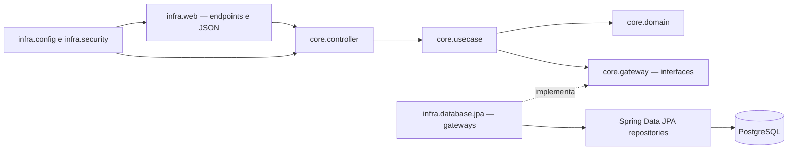

# API de Restaurantes — Tech Challenge Fase 2

API REST para cadastro e gerenciamento de restaurantes, tipos de usuário e itens de cardápio. O projeto foi desenvolvido em Java com Spring Boot e organizado em camadas seguindo os princípios de Clean Architecture.

## Funcionalidades

- Autenticação HTTP Basic e consulta do usuário autenticado.
- CRUD de restaurantes, com validação de que operações de escrita sejam feitas pelo proprietário.
- CRUD de tipos de usuário. Os tipos de sistema `CLIENTE` e `DONO` são protegidos contra alteração e exclusão.
- CRUD de itens de cardápio vinculados a um restaurante.
- Validação de dados de entrada e respostas de erro no formato `ProblemDetail`.
- Versionamento do banco de dados com Flyway.

O sistema possui tabela e usuários pré-cadastrados para autenticação, mas não expõe CRUD de usuários. A associação inicial entre usuário e tipo é feita pelas migrations do banco.

## Tecnologias

- Java 21
- Spring Boot 4.1.1, Spring Web MVC e Spring Data JPA
- Spring Security com HTTP Basic
- PostgreSQL 17
- Flyway
- JUnit, Spring MockMvc, H2 e JaCoCo para testes

## Arquitetura

O código separa as regras de negócio dos detalhes de HTTP e persistência:



### Principais pacotes

| Pacote | Responsabilidade |
|---|---|
| `core.domain` | Entidades e regras de validação do domínio, como campos obrigatórios e preço positivo. |
| `core.usecase` | Casos de uso, regras de autorização e coordenação dos gateways. |
| `core.gateway` | Interfaces que definem as operações de persistência necessárias ao núcleo. |
| `core.controller` | Fachadas que encaminham as chamadas da camada web aos casos de uso. |
| `core.dto` | Objetos de entrada e saída usados entre as camadas. |
| `infra.web` | Endpoints REST, conversão de JSON e tratamento centralizado de erros. |
| `infra.database.jpa` | Implementações JPA dos gateways, entidades e repositórios. |
| `infra.database.mapper` | Conversão entre entidades JPA e objetos de domínio. |
| `infra.security` | Carregamento de usuários, identidade autenticada e codificação de senhas. |
| `infra.config` | Configuração de segurança e criação dos componentes da aplicação. |

## Requisitos

- JDK 21 configurado em `JAVA_HOME`.
- Docker com Docker Compose, ou uma instância PostgreSQL compatível configurada para o projeto.
- Portas `5432` (PostgreSQL) e `8080` (API) disponíveis, salvo se você alterar as configurações.

## Configuração e execução

### 1. Iniciar o PostgreSQL local

O `docker-compose.yml` cria um banco local chamado `restaurantes`:

```powershell
docker compose up -d postgres
```

Configuração local padrão:

| Propriedade | Valor |
|---|---|
| Host e porta | `localhost:5432` |
| Banco | `restaurantes` |
| Usuário | `postgres` |
| Senha | `postgres` |

Esses valores estão em `docker-compose.yml` e `src/main/resources/application.yaml`. Para outro banco, ajuste as propriedades `spring.datasource` nesse arquivo ou sobrescreva-as pelas propriedades de ambiente do Spring Boot.

### 2. Compilar e iniciar a API

No PowerShell, a partir da pasta do projeto:

```powershell
.\mvnw.cmd spring-boot:run
```

Em Linux ou macOS:

```bash
./mvnw spring-boot:run
```

O Spring Boot executa automaticamente as migrations Flyway na inicialização. A API fica disponível em `http://localhost:8080`.

### 3. Documentação OpenAPI

Com a aplicação em execução, acesse:

- Swagger UI: <http://localhost:8080/swagger-ui.html>
- OpenAPI JSON: <http://localhost:8080/v3/api-docs>

Esses dois caminhos são públicos. Os demais endpoints da API exigem autenticação.

## Banco de dados e migrations

As migrations ficam em `src/main/resources/db/migration`:

| Migration | Conteúdo |
|---|---|
| `V1__tabelas.sql` | Cria tabelas de tipos de usuário, endereços, usuários, restaurantes e itens de cardápio, com chaves estrangeiras. |
| `V2__inserts.sql` | Insere os tipos `CLIENTE` e `DONO` e usuários locais para autenticação. |
| `V3__marcar_tipos_usuario_sistema.sql` | Adiciona a indicação de tipo de sistema e marca `CLIENTE` e `DONO` como protegidos. |

Hibernate usa `ddl-auto: validate`: a estrutura esperada pelas entidades é validada, mas a criação e evolução do schema pertencem ao Flyway.

## Autenticação e autorização

Todas as rotas da API, exceto Swagger/OpenAPI, usam **HTTP Basic**. No Postman, escolha **Authorization → Basic Auth** e informe o usuário e a senha.

Usuários criados pelas migrations locais:

| Login | Senha local | Tipo |
|---|---|---|
| `cliente` | `123456` | `CLIENTE` |
| `dono` | `123456` | `DONO` |
| `dono2` | `123456` | `DONO` |

Essas credenciais são somente para desenvolvimento e testes locais.

- O usuário autenticado é obtido pelo contexto de segurança; o cliente não informa o ID do proprietário no corpo do cadastro.
- Somente usuários `DONO` podem cadastrar restaurantes e administrar tipos de usuário.
- A atualização e exclusão de restaurante exigem que o usuário autenticado seja o proprietário daquele restaurante.
- A criação, atualização e exclusão de item de cardápio também exigem o proprietário do restaurante relacionado.
- `CLIENTE` e `DONO` são tipos de sistema: a API não permite renomeá-los ou excluí-los. Tipos personalizados podem ser administrados por um `DONO`.

Para conferir a identidade autenticada, use `GET /v1/auth/me`.

## Endpoints da API

Todas as rotas abaixo exigem autenticação Basic, exceto quando indicado. Os IDs nas rotas são UUIDs.

### Autenticação

| Método | Rota | Acesso | Resposta |
|---|---|---|---|
| `GET` | `/v1/auth/me` | Qualquer usuário autenticado | `200 OK` com ID, login e tipo do usuário autenticado. |

Exemplo:

```json
{
  "id": "44444444-4444-4444-4444-444444444444",
  "login": "dono",
  "tipoUsuario": "DONO"
}
```

### Tipos de usuário

| Método | Rota | Acesso | Resposta principal |
|---|---|---|---|
| `POST` | `/v1/tipo-usuario` | `DONO` | `201 Created` |
| `GET` | `/v1/tipo-usuario` | Autenticado | `200 OK` |
| `GET` | `/v1/tipo-usuario/{id}` | Autenticado | `200 OK` ou `404 Not Found` |
| `PUT` | `/v1/tipo-usuario/{id}` | `DONO`; tipos de sistema protegidos | `200 OK` |
| `DELETE` | `/v1/tipo-usuario/{id}` | `DONO`; tipos de sistema protegidos | `204 No Content` |

Corpo de criação e atualização:

```json
{
  "nomeTipo": "GERENTE"
}
```

O nome não pode ser vazio. O nome precisa ser único. Criar nome duplicado retorna `409 Conflict`.

### Restaurantes

| Método | Rota | Acesso | Resposta principal |
|---|---|---|---|
| `POST` | `/v1/restaurantes` | `DONO` | `201 Created` |
| `GET` | `/v1/restaurantes` | Autenticado | `200 OK` |
| `GET` | `/v1/restaurantes/{id}` | Autenticado | `200 OK` ou `404 Not Found` |
| `PUT` | `/v1/restaurantes/{id}` | Proprietário autenticado | `200 OK` |
| `DELETE` | `/v1/restaurantes/{id}` | Proprietário autenticado | `204 No Content` |

Corpo de criação e atualização:

```json
{
  "nome": "Restaurante Central",
  "endereco": {
    "rua": "Rua das Flores",
    "numero": "123",
    "bairro": "Centro",
    "cidade": "Recife",
    "estado": "PE",
    "cep": "50000-000"
  },
  "tipoCozinha": "Brasileira",
  "horarioFuncionamento": "10:00 às 22:00"
}
```

O proprietário é definido pelo usuário autenticado. Não envie um ID de usuário no corpo.

### Itens de cardápio

Os itens são acessados dentro da rota do restaurante ao qual pertencem.

| Método | Rota | Acesso | Resposta principal |
|---|---|---|---|
| `POST` | `/v1/restaurantes/{restauranteId}/itens-cardapio` | Proprietário autenticado | `201 Created` |
| `GET` | `/v1/restaurantes/{restauranteId}/itens-cardapio` | Autenticado | `200 OK` |
| `GET` | `/v1/restaurantes/{restauranteId}/itens-cardapio/{itemCardapioId}` | Autenticado | `200 OK` ou `404 Not Found` |
| `PUT` | `/v1/restaurantes/{restauranteId}/itens-cardapio/{itemCardapioId}` | Proprietário autenticado | `200 OK` |
| `DELETE` | `/v1/restaurantes/{restauranteId}/itens-cardapio/{itemCardapioId}` | Proprietário autenticado | `204 No Content` |

Corpo de criação e atualização:

```json
{
  "nome": "Baião de dois",
  "descricao": "Prato da casa",
  "preco": 32.50,
  "apenasNoRestaurante": false,
  "foto": "https://exemplo.com/imagens/baiao.jpg"
}
```

Nome, descrição e caminho da foto são obrigatórios. O preço deve ser maior que zero e `apenasNoRestaurante` deve ser informado como booleano.

### Observações sobre as respostas

- As listas são envolvidas em objetos: `restaurantes`, `tipos` e `itens`.
- A resposta de criação de restaurante e de item inclui o `id` gerado. As respostas de consulta e atualização desses dois recursos não incluem o ID; use o ID recebido na criação para montar as próximas rotas.
- As respostas de tipo de usuário incluem `id`, `nomeTipo` e `sistema`.
- Exclusões bem-sucedidas retornam `204 No Content`, sem corpo.

## Erros HTTP

Os erros da aplicação são retornados como `application/problem+json`, com propriedades como `status`, `title`, `detail` e `instance`.

| Status | Significado neste projeto |
|---|---|
| `400 Bad Request` | JSON inválido, campo obrigatório ausente ou dado que não passa pela validação. |
| `401 Unauthorized` | Requisição sem credenciais válidas. |
| `403 Forbidden` | Usuário autenticado sem perfil `DONO` ou que não é proprietário do recurso. |
| `404 Not Found` | Restaurante, tipo ou item não encontrado. Um item consultado dentro do restaurante errado também é tratado como não encontrado. |
| `409 Conflict` | Tipo de usuário duplicado ou tentativa de alterar/excluir tipo de sistema. |

Exemplo de resposta de erro:

```json
{
  "type": "about:blank",
  "title": "Forbidden",
  "status": 403,
  "detail": "Apenas usuários com perfil DONO podem cadastrar restaurantes",
  "instance": "/v1/restaurantes"
}
```

## Testes e cobertura

Os testes unitários cobrem regras de domínio e casos de uso. Os testes de integração exercitam endpoints, segurança, persistência JPA e migrations. A suíte usa H2 em modo de compatibilidade PostgreSQL e não precisa acessar o banco de desenvolvimento.

No Windows/PowerShell:

```powershell
.\mvnw.cmd test
.\mvnw.cmd verify
```

No Linux/macOS:

```bash
./mvnw test
./mvnw verify
```

`verify` executa os testes, gera o relatório JaCoCo e verifica o limite mínimo configurado de 80% de cobertura de linhas. O relatório HTML é criado em `target/site/jacoco/index.html`.
